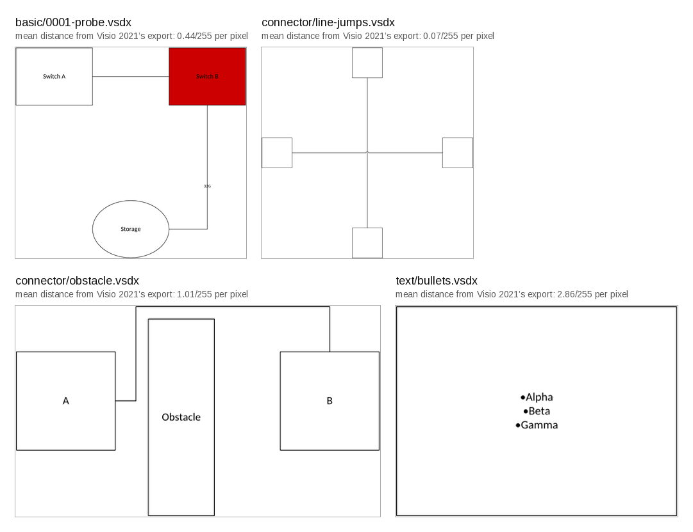

# DiagramCraft

A clean-room, headless Rust core of Microsoft Visio. It opens .vsdx, .vssx and .vstx files,
evaluates the ShapeSheet the way Visio does, and renders pages and stencils to PNG, SVG and
PDF. Writing files that Visio opens unrepaired, connectors and routing, and an MCP server for
AI agents are in progress. It is built in the mould of the Craft apps (deckcraft, vectorcraft
and their siblings) and is offered to that project.



*DiagramCraft's own renders. Each label gives the mean per-pixel distance from Visio 2021's PNG
export of the same file, measured by the test harness; Visio's exports stay out of the repository.*

## What works today (2026-10-13)

- **Open** every one of the 1,181 stencils and templates that ship with Visio 2021, plus a
  204-drawing test corpus, with zero errors and zero panics under mutation fuzzing.
- **Evaluate** the ShapeSheet: 104 functions, inheritance from masters, style sheets and
  document defaults, dirty-set recalculation. Measured against Visio itself: 97.7% of 4.8
  million formula cells match the value Visio cached in the file, and 98.5% of 44.7 million
  cells match Visio's live COM dumps, theme and text-metric cells included.
- **Render** PNG, SVG and vector PDF. Every feature group of the test corpus is inside fixed
  pixel ceilings against Visio's own 96 dpi export, and all 1,108 masters in the review
  stencil set render.
- **Round-trip** read, write, read: 15.1 million cells preserved across 1,387 packages. In
  the first full acceptance run Visio opened all 230 files the writer produced, five of them
  built from scratch. That run also found four writer defects (inherited cell values, master
  shape IDs, background page relationships, connector instances), so unrepaired saving is
  not claimed yet.

Known gaps are listed in [docs/gaps.md](docs/gaps.md). Text wrapping is the weakest area,
EMF+ images are not drawn, and compound line patterns are approximate.

## Try it

```sh
cargo build --release
cargo run --release -p diagramcraft-cli -- info drawing.vsdx
cargo run --release -p diagramcraft-cli -- sheet drawing.vsdx --page 1
cargo run --release -p diagramcraft-cli -- render drawing.vsdx --page 1 out.png
```

`info` lists the package parts. `sheet` prints every evaluated cell in the same columns as a
Visio COM dump, so the two diff directly. `render` also takes `.svg` and `.pdf` output names,
and `--masters stencil.vssx` draws a contact sheet of a stencil. No binaries are published yet;
Rust stable with edition 2024 is required. There is no GUI and none is planned in this repo.

## What is coming

- Phase 3, in closure: write .vsdx, .vssx and .vstx that Visio opens without repair, and
  build documents from scratch.
- Phase 4: authoring commands, master instancing, glue, orthogonal connector routing.
- Phase 5: an MCP server and pptx export, so an AI agent can build a diagram from a
  description and hand over a file Visio opens.

See [ROADMAP.md](ROADMAP.md) for the milestones and the numbers each one has to reach.

## How it is built

Clean room. Visio is observed only as a black box, on drawings this repo's own scripts made,
in a licensed copy of Visio Standard 2021. File formats come from Microsoft's published
references, cited in doc comments and collected in [docs/sources.md](docs/sources.md). No
Microsoft stencils, templates, icons or fonts are in this repository; the reference corpus is
private for that reason, and the scripts to regenerate it with your own Visio are in
[tools/oracle](tools/oracle/). Every milestone is a number produced by the test harness against
Visio's output, with floors that only rise. Details are in
[docs/provenance.md](docs/provenance.md).

Code reused from the Craft apps is MIT OR Apache-2.0 and is listed per file in
[ATTRIBUTION.md](ATTRIBUTION.md).

## Status and handover

Pre-alpha. Milestones M0 to M2 are met and independently reviewed; M3 (writing) is in
closure. The name follows the Craft apps' convention and belongs to that project: if they
adopt this work, it transfers with the name; if not, the name changes. Issues and discussion
are welcome.

## Development

Build gates, the oracle VM workflow, corpus pinning and contact sheets are in
[docs/development.md](docs/development.md). Operating rules for agents are in
[AGENTS.md](AGENTS.md); layers and architecture in [docs/architecture.md](docs/architecture.md).

## Licence

MIT OR Apache-2.0; see LICENSE-MIT, LICENSE-APACHE and NOTICE. The embedded fonts Carlito,
Caladea, Arimo, Tinos and Cousine are under the SIL Open Font License 1.1.
