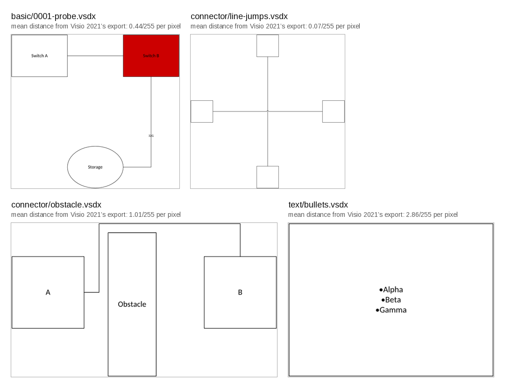
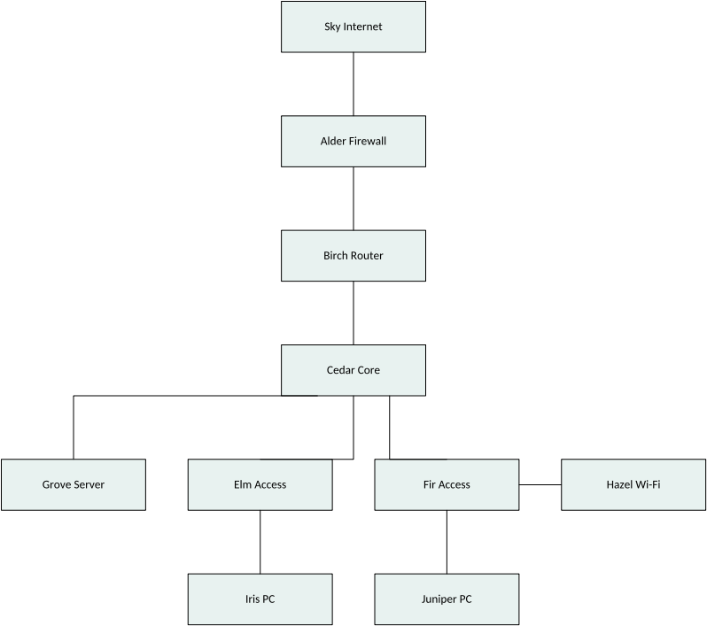

# MisterDiagram


*Your diagrams, as requested.* (Visio files without Visio!)

Tell Claude what you want drawn, in plain English, and get a real Visio .vsdx back.
MisterDiagram has no GUI. Its interface is an MCP server (and a CLI for scripts), and its output
is a file that opens in Visio without a repair prompt. "Make a flowchart of our onboarding
process", "draw the org chart for these twelve people", "a network diagram with two offices, a
firewall each and a VPN between them" become shapes dropped from stencils, glued connectors
routed the way Visio routes them, and a .vsdx you can hand to whoever still has Visio.

Underneath is a clean-room, headless Rust implementation of Visio's file format and ShapeSheet.
It reads and writes Visio drawings, stencils and templates, renders them to PNG, SVG and PDF,
and exports them to PowerPoint. Each claim below has been measured against what Visio 2021 (and
PowerPoint 2021, for the export) does with the same file.

**Download:** [MisterDiagram 0.1.0-beta.6](https://github.com/MisterDiagram/MisterDiagram/releases/tag/v0.1.0-beta.6),
the sixth beta (compact MCP lookups for cheaper agent sessions, fonts by name), for macOS
(universal), Windows (x64 and arm64) and Linux (x64 and arm64). The
binaries are unsigned; [docs/install.md](docs/install.md) covers checksums, the first-run
warnings and MCP setup. Testers wanted: see [below](#testers-wanted).



*MisterDiagram's own renders. Each label gives the mean per-pixel distance from Visio 2021's PNG
export of the same file, measured by the test harness; Visio's exports stay out of the repository.*

## Use it with Claude

1. Download the archive for your platform and unpack it. [docs/install.md](docs/install.md)
   walks through the first-run warnings on macOS and Windows.
2. Register the server with Claude Code, using the full path to the binary:

   ```sh
   claude mcp add misterdiagram -- /full/path/to/misterdiagram mcp
   ```

   Any MCP client works the same way: `misterdiagram mcp` speaks MCP over stdin and stdout.
   [docs/install.md](docs/install.md#6-use-it-from-an-ai-agent-mcp) has the setup for other
   clients and for Windows paths.
3. Ask for a drawing, and say where to save it: "draw our two-office network with a firewall in
   each and save it as offices.vsdx", then "export it to PNG" or "export it to PowerPoint".

The server has seventeen tools: open, save, render and export documents, inspect documents and
shapes, search and open stencils, drop masters, connect shapes, read and set ShapeSheet cells,
and run any engine command or a batch of them. [docs/mcp.md](docs/mcp.md) lists them with examples, including the office, SAN and
fabric drawings the tests build.

## What works today (2026-11-10, 0.1.0-beta.6)

- **Open** .vsdx, .vssx and .vstx files, and the macro-enabled .vsdm, .vssm and .vstm (the VBA
  is dropped). Every stencil and template that ships with Visio 2021 opens.
- **Evaluate** the ShapeSheet the way Visio does, with inheritance from masters, style sheets
  and document defaults.
- **Render** pages and stencils to PNG, SVG and PDF, close to Visio's own export. Text in SVG
  and PDF stays real text you can search and select.
- **Write** drawings Visio opens without a repair prompt, including drawings built from scratch.
- **Draw** shapes, stencil masters, shape data, hyperlinks and layers, with connectors glued to
  their shapes and routed the way Visio routes them, line jumps included. Tree, row and fan
  layout place the shapes for you. A built-in network stencil has eleven device masters.
- **Export to PowerPoint** with native shapes, editable text, and connectors that stay attached
  when you move a shape. What PowerPoint cannot hold is named and warned at export.
- **Script** the same commands from the CLI, so a drawing generated from data can be rebuilt
  when the data changes.

M4 met its plan gates on 2026-10-15 and M5 on 2026-11-04. CI runs all eight gates on Linux,
Windows and macOS, plus an Ubuntu check at the declared Rust minimum.

<details>
<summary>The measurements behind these claims</summary>

- **Open** every one of the 1,181 stencils and templates that ship with Visio 2021, plus a
  generated drawing corpus, with zero errors and zero panics under mutation fuzzing.
- **Evaluate** the ShapeSheet: 122 functions including 3 internal functions, from
  `crates/sheet/src/functions/mod.rs`'s `IMPLEMENTED` registry. Inheritance covers
  masters, style sheets and document defaults, with dirty-set recalculation. The full
  oracle check passes its fixed floors, including 62,415/67,866 cached text metrics
  and 54,548/58,180 COM text metrics.
- **Render** PNG, SVG and vector PDF. All aggregate feature groups of the test corpus pass their
  fixed pixel ceilings against Visio's own 96 dpi export. Individual connector comparisons
  remain above their ceilings and are tracked as a renderer gap: they are measured and reported
  as informational until the connector stroke rendering gap closes, and route acceptance is
  cell and geometry equality with Visio plus the unchanged group ceilings. All 1,108 masters in
  the review stencil set render. The vendor inventory renders 6,678/6,742 masters with zero
  blanks or guard kills; the remaining 64 are named gaps. PDF text extracts with ligatures and
  combining marks intact, and SVG text is `<text>` that can be searched, selected and edited.
  Use `--font-names exact` to name only the document face.
- **Export PowerPoint**: PowerPoint 2021 opens the acceptance set without repair and keeps
  connectors and labels with their shapes when they move. The office, SAN and fabric drawings
  built through MCP open with all 18, 80 and 20 connectors attached. Fifteen exports were checked
  in PowerPoint; its render of each is within a few levels of ours (the radial gradient is the
  largest difference). In the corpus check, 183 of 230 generated pages are exact against the
  exporter's own raster, with 47 named substitutions and label groups 80/3.
- **Write** .vsdx, .vssx and .vstx, and build documents from scratch. Visio 2021 opened all
  230 files of the acceptance set, five of them built from scratch, with no repair beyond a
  few disclosed metadata rewrites, and its COM dumps of the reopened files show zero
  differences. Read, write, read preserves all 15.1 million cells across 1,413 packages.
- **Author** through schema-described commands in a transactional session: pages, layers,
  shapes, text, shape data, hyperlinks, formatting, stencils and master drops, connection
  points, static and dynamic glue, and connector routing. Routes match Visio's own on 28 of
  29 witness drawings (obstacles, route styles, page preferences and line jumps) within one
  millionth of an inch; the one gap is a 1/64 in packing shift where three connectors cross.
  The 24-switch, 40-connector topology keeps every route when Visio re-saves it, and its
  equal-size export matches ours inside the pixel ceilings. The office, SAN and fabric examples
  retain 18/80/20 Connects after Visio re-save with zero repair or route differences. Office
  and SAN pass layout checks; fabric retains its documented box and heading crossings.
- **Automate** through seventeen MCP tools or CLI scripts: atomic reference batches, styled
  creation, connector creation, built-in network masters, tree/row/fan layout and layout
  checks. Compact command lists, page outlines and label search keep lookups small. Unsaved-change protection, panic recovery
  and bounded malformed-line recovery keep sessions usable. CLI scripts can rebuild drawings
  from data with `run --batch FILE`. The built-in network stencil provides eleven semantic
  device masters as native editable geometry via `stencil.open {"builtin":"network"}`.

The rulings behind each gate are dated in [ROADMAP.md](ROADMAP.md).

</details>

## Known gaps

Rendering is close to Visio, but it is not complete appearance or cell parity. The main limits:

- Some details still differ from Visio: timeline labels, 3D rotation, shadows, fine equipment
  details and a few theme colours.
- Container and list formulas, text wrapping, routing on larger pages, legacy formats, EMF+
  and compound line patterns are limited.
- When a connector reroutes, it takes this router's path, which can differ from the one Visio
  would pick.
- PowerPoint export approximates what PowerPoint cannot hold: pattern fills, shadows, compound
  lines and line jumps ([details](docs/gaps.md#powerpoint-export-partial)).
- Authoring large drawings is slow ([#39](https://github.com/MisterDiagram/MisterDiagram/issues/39)).
- Open tester reports: [#88, #91, #103 and #118](https://github.com/MisterDiagram/MisterDiagram/issues)
  (a `THEME()` colour argument, the Text Callout cycle, SVG import, text wrapping inside a
  long word).

Every gap, with its measurements, is in [docs/gaps.md](docs/gaps.md).

<details>
<summary>The full list</summary>

All 85 native-opened field files now render, but this is not complete appearance or cell
parity. Timeline date labels, milestone positions and two caption colours, stored ActiveX
versus live-control appearance, 3D rotation, fine equipment details, repeated-master strict
evaluation and some master cells still differ. THEMEVAL retains 2,550 unequal secondary
backgrounds and dormant gradient angles. Container/list formulas, text wrapping, larger-page
routing, legacy formats, EMF+, compound line patterns, shadows, PowerPoint pattern fills and
masters with several top-level shapes remain limited. Large-drawing authoring is slow
([#39](https://github.com/MisterDiagram/MisterDiagram/issues/39); measurements in
docs/gaps.md). From Microsoft's template catalogue, filed and open: `THEME()` with a colour
argument (#88) and the Text Callout cycle (#91). From the first batch of real company files,
filed and open: SVG import (#103). The 2026-11-03 batch (#112 to #117) is closed. Text can wrap inside a long word at `_`, `:`
or `}` where Visio keeps it on one line (#118). Text in
an embedded picture that uses a symbol font or glyph indexes stays as outlines in SVG. One
field page sits about 15 px off Visio's image (a small aspect difference). Gradient
directions 10 to 13 keep a corner fallback, and gradients
with more than two stops keep a small angle difference from Visio.
SVG export does not write Visio's `v:` extension data, which Visio
reads when it imports an SVG. The bundled symbol face covers the dingbat, geometric, arrow and
pictograph blocks; Segoe UI Symbol's mathematics and Windows icon ranges, and the Wingdings and
Webdings symbol-charset fonts, are not covered (docs/gaps.md). Where a connector does reroute,
the path is this router's, not Visio's: all three connectors that rerouted on the witness
drawings differ from Visio's path (two take the other side of the obstacle, one bends
elsewhere); the 28 of 29 geometry witnesses still hold.

</details>

## New in 0.1.0-beta.6

- MCP lookups are compact. `list_commands` returns command ids with parameter names (about
  9 KB where it was 70 KB) and full schemas only for the `ids` you ask for; `inspect_document`
  returns a page outline, finds shapes by label with `find`, and reports fill, line and text
  values through the `style` section in the form the format commands accept. `run_command` and
  `batch` get the same defaults; `detail:"full"` and `sections:["listing"]` return the full
  forms.
- Fonts set by a command open in Visio as the font you chose. The font is saved by name, as
  Visio saves it (witnessed in Visio 2021); files from earlier builds keep their old value
  until the font is applied again.

Against beta.5, nine scripted agent edits on three real drawings draw 82% fewer bytes of MCP
replies (2.94 MB to 0.53 MB), and a 248-shape page that was over the inspection budget outlines
in 18 KB. The saving on a model bill depends on the client. PNG, SVG, PDF and PowerPoint
output is byte-identical on every witness (all 123 field images, all 698 corpus lines). The
full list of changes is in [CHANGELOG.md](CHANGELOG.md).

## Testers wanted

MisterDiagram has been checked against Visio 2021 on drawings its own scripts made. Real
drawings are the next test, and that needs people who use Visio at work. Beta binaries for
macOS, Windows and Linux are on the
[Releases page](https://github.com/MisterDiagram/MisterDiagram/releases);
[docs/install.md](docs/install.md) covers download, checksums, the first-run warnings for
unsigned binaries and MCP setup. The most useful things to try:

- Open your own .vsdx, .vssx and .vstx files with `info` and `render`. Tell us which files
  fail to open and where a render differs from what Visio shows.
- If you have Visio, open the files MisterDiagram writes and tell us whether Visio repairs
  anything or draws them differently.
- Point an AI agent at the MCP server ([setup above](#use-it-with-claude)) and ask it for a
  network or SAN drawing. Tell us what it could not do, or did wrong.
- Try vendor stencils (network, storage, server) and tell us which masters fail to drop,
  glue or render.

Report each finding as an [issue](https://github.com/MisterDiagram/MisterDiagram/issues),
with the command you ran and what you expected. Please do not attach drawings that hold
customer names, addresses or other private data: a small file that shows the same problem,
or a screenshot and a description, is enough.

## Command line

```sh
misterdiagram info drawing.vsdx
misterdiagram sheet drawing.vsdx --page 1
misterdiagram render drawing.vsdx --page 1 out.png
misterdiagram convert drawing.vsdx out.pptx
```

`info` lists the package parts. `sheet` prints every evaluated cell in the same columns as a
Visio COM dump, so the two diff directly. `render` also takes `.svg`, `.pdf` and `.pptx` output
names, and `--masters stencil.vssx` draws a contact sheet of a stencil. `render` and `convert`
accept `--fit` to crop PNG, SVG and PDF to foreground drawing content, including off-page
shapes. Add `--margin "0.25 in"` or `--margin "5 mm"` for padding on every side. No page margin
is added automatically. An empty fitted page keeps its original page size and reports a warning.

Session retention defaults to a 2 GiB ceiling; use `--memory-limit <MiB>` or
`MISTERDIAGRAM_MEMORY_LIMIT` (the flag wins) to change it without changing any per-file
admission bound.

To build from source you need Rust stable with edition 2024:

```sh
cargo build --release
target/release/misterdiagram info drawing.vsdx
```

### Generate a drawing

Build the CLI with `cargo build -p misterdiagram-cli`, then run this script from the
repository root. The built-in network library provides eleven semantic device masters with native geometry; this example places them with tree layout and fits the page.

<!-- office-network:start -->
```bash
#!/usr/bin/env bash
# Contributor-original office network, MIT OR Apache-2.0. Run from the repository root.
set -euo pipefail
cli="${MISTERDIAGRAM_CLI:-target/debug/misterdiagram}"
out="${1:-target/office-network}"; image="${2:-docs/images/office-network.png}"
mkdir -p "$out" "$(dirname "$image")"
args=(--cmd 'stencil.open={"builtin":"network"}')
names=('Sky Internet' 'Alder Firewall' 'Birch Router' 'Cedar Core' 'Elm Access' 'Fir Access' 'Grove Server' 'Hazel Wi-Fi' 'Iris PC' 'Juniper PC')
masters=(network.cloud network.firewall network.router network.switch.core network.switch.access network.switch.access compute.server network.wireless_ap compute.desktop compute.desktop)
for i in "${!names[@]}"; do
  args+=(--cmd "master.drop={\"master\":\"${masters[$i]}\"}" --cmd "shape.text={\"id\":$((i+1)),\"text\":\"${names[$i]}\"}")
done
args+=(--cmd 'layout.tree={"root":1,"edges":[[1,2],[2,3],[3,4],[4,7],[4,5],[4,6],[5,9],[6,10],[6,8]],"gutter_x":2,"gutter_y":0.5,"fit_page":true}')
"$cli" run "${args[@]}" --save "$out/office-network.vsdx"
"$cli" convert "$out/office-network.vsdx" "$image"
```
<!-- office-network:end -->



The same script is [tools/examples/office-network.sh](tools/examples/office-network.sh).
It saves `target/office-network/office-network.vsdx` and renders the image above.
Check it with `python3 tools/check-layout.py target/office-network/office-network.vsdx --cli target/debug/misterdiagram --root 1 --fit-page`.
`run` commits each command separately. Page numbers are one-based in Visio's order (foreground pages first, then background pages), shape IDs are
document IDs, lengths use inches and angles use radians. `commands` and `describe`
print the command schemas. `misterdiagram mcp` serves the same engine over stdio;
see [the tools and examples](docs/mcp.md).

## What is coming

- Fidelity after the first beta: new tester findings as they land, Word export, and
  the carried gaps below.
- Carried gaps, named in [docs/gaps.md](docs/gaps.md): the three-crossing packing shift,
  unwitnessed WalkPreference values, theme.apply (Visio refused the variant call under
  COM), connector stroke rendering, and export mapping for small images.

See [ROADMAP.md](ROADMAP.md) for the milestones and the numbers each one has to reach.

## Status

Beta. Milestones M0 to M5 (reading, evaluation, rendering, writing, authoring and routing, then
MCP, layout and PowerPoint export) are met and independently reviewed, each under dated gate
rulings recorded in the roadmap. The commands and MCP tools are settled; the work from here is
correctness and fidelity, driven by tester reports. There is no GUI and none is planned in this
repo, but anyone is welcome to build one on top: the core is the part that has to be right.

The canonical repository is
[github.com/MisterDiagram/MisterDiagram](https://github.com/MisterDiagram/MisterDiagram).
Issues, discussion and pull requests go to this repository.

## How it is built

Clean room. Visio is observed only as a black box, on drawings this repo's own scripts made,
in a licensed copy of Visio Standard 2021. File formats come from Microsoft's published
references, cited in doc comments and collected in [docs/sources.md](docs/sources.md). No
Microsoft stencils, templates, icons or fonts are in this repository; the reference corpus is
private for that reason, and the scripts to regenerate it with your own Visio are in
[tools/oracle](tools/oracle/). Every milestone is a number produced by the test harness against
Visio's output, with floors that only rise. Details are in
[docs/provenance.md](docs/provenance.md).

It is built in the mould of the Craft apps (deckcraft, vectorcraft and their siblings) and
shares their conventions. Code reused from them is MIT OR Apache-2.0 and is listed per file in
[ATTRIBUTION.md](ATTRIBUTION.md).

The project was called DiagramCraft until 2026-10-16, when it was renamed out of respect for
[DiagramCraft](https://github.com/DiagramCraft/diagram-craft), an older open-source diagram
editor with that name.

MisterDiagram is not affiliated with, endorsed by or sponsored by Microsoft.
Microsoft Visio is a trademark of Microsoft Corporation.

## Development

Build gates, the oracle VM workflow, corpus pinning and contact sheets are in
[docs/development.md](docs/development.md). Operating rules for agents are in
[AGENTS.md](AGENTS.md); layers and architecture in [docs/architecture.md](docs/architecture.md).

## Licence

MIT OR Apache-2.0; see LICENSE-MIT, LICENSE-APACHE and NOTICE. The embedded fonts Carlito,
Caladea, Arimo, Tinos and Cousine are under the SIL Open Font License 1.1.
