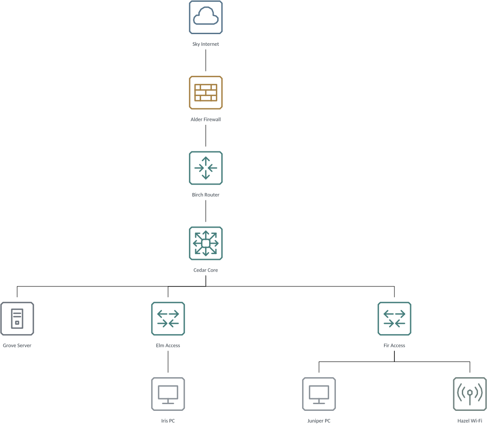

# MisterDiagram


*Your diagrams, as requested.* (Visio files without Visio!)

Formerly DiagramCraft; renamed on 2026-10-16 out of respect for
[DiagramCraft](https://github.com/DiagramCraft/diagram-craft), an older open-source diagram
editor with that name.

A clean-room, headless Rust core of Microsoft Visio. It opens .vsdx, .vssx and .vstx files, and their macro-enabled .vsdm, .vssm and .vstm variants with the VBA payload dropped,
evaluates the ShapeSheet the way Visio does, renders pages and stencils to PNG, SVG and
PDF, writes files that Visio opens without repair, and authors drawings from commands: shapes,
masters, shape data, glued connectors with orthogonal routing and line jumps. AI agents can use the same commands through the MCP stdio server. PowerPoint export is next. It is built in the mould of the Craft apps (deckcraft,
vectorcraft and their siblings) and is offered to that project.


*MisterDiagram's own renders. Each label gives the mean per-pixel distance from Visio 2021's PNG
export of the same file, measured by the test harness; Visio's exports stay out of the repository.*

## What works today (2026-10-15)

- **Open** every one of the 1,181 stencils and templates that ship with Visio 2021, plus a
  204-drawing test corpus, with zero errors and zero panics under mutation fuzzing.
- **Evaluate** the ShapeSheet: 104 functions, inheritance from masters, style sheets and
  document defaults, dirty-set recalculation. Measured against Visio itself: 97.8% of 4.8
  million formula cells match the value Visio cached in the file, and 98.4% of 76.2 million
  cells match Visio's live COM dumps, theme and text-metric cells included.
- **Render** PNG, SVG and vector PDF. All aggregate feature groups of the test corpus pass their fixed
  pixel ceilings against Visio's own 96 dpi export. Individual connector comparisons
  remain above their ceilings and are tracked as a renderer gap. All 1,108 masters in the
  review stencil set render. PDF text extracts with ligatures and combining marks intact.
- **Write** .vsdx, .vssx and .vstx, and build documents from scratch. Visio 2021 opened all
  230 files of the acceptance set, five of them built from scratch, with no repair beyond a
  few disclosed metadata rewrites, and its COM dumps of the reopened files show zero
  differences. Read, write, read preserves all 15.1 million cells across 1,413 packages.
- **Author** through schema-described commands in a transactional session: pages, layers,
  shapes, text, shape data, hyperlinks, formatting, stencils and master drops, connection
  points, static and dynamic glue, and connector routing. Routes match Visio's own on 28 of
  29 witness drawings (obstacles, route styles, page preferences and line jumps) within one
  millionth of an inch; the one gap is a 1/64 in packing shift where three connectors cross.
  The 24-switch, 40-connector topology keeps every route when Visio re-saves it,
  and its equal-size export matches ours inside the pixel ceilings. The current SAN and
  office examples still have serialization changes on Visio save, tracked in the
  gaps below. CI runs the full gate set on Linux, Windows and macOS for every push.

Known gaps are listed in [docs/gaps.md](docs/gaps.md). Text wrapping is the weakest area,
EMF+ images are not drawn, and compound line patterns are approximate.

## Try it

```sh
cargo build --release
cargo run --release -p misterdiagram-cli -- info drawing.vsdx
cargo run --release -p misterdiagram-cli -- sheet drawing.vsdx --page 1
cargo run --release -p misterdiagram-cli -- render drawing.vsdx --page 1 out.png
```

`info` lists the package parts. `sheet` prints every evaluated cell in the same columns as a
Visio COM dump, so the two diff directly. `render` also takes `.svg` and `.pdf` output names,
and `--masters stencil.vssx` draws a contact sheet of a stencil. No binaries are published yet;
Rust stable with edition 2024 is required. There is no GUI and none is planned in this repo.

### Generate a drawing

Build the CLI with `cargo build -p misterdiagram-cli`, then run this script from the
repository root. The built-in network library provides eleven semantic device masters with native geometry; this example places them with tree layout and fits the page.

<!-- office-network:start -->
```bash
#!/usr/bin/env bash
# Contributor-original office network, MIT OR Apache-2.0. Run from the repository root.
set -euo pipefail
cli="${MISTERDIAGRAM_CLI:-target/debug/misterdiagram}"
out="${1:-target/office-network}"; image="${2:-docs/images/office-network.png}"
mkdir -p "$out" "$(dirname "$image")"
args=(--cmd 'stencil.open={"builtin":"network"}')
names=('Sky Internet' 'Alder Firewall' 'Birch Router' 'Cedar Core' 'Elm Access' 'Fir Access' 'Grove Server' 'Hazel Wi-Fi' 'Iris PC' 'Juniper PC')
masters=(network.cloud network.firewall network.router network.switch.core network.switch.access network.switch.access compute.server network.wireless_ap compute.desktop compute.desktop)
for i in "${!names[@]}"; do
  args+=(--cmd "master.drop={\"master\":\"${masters[$i]}\"}" --cmd "shape.text={\"id\":$((i+1)),\"text\":\"${names[$i]}\"}")
done
args+=(--cmd 'layout.tree={"root":1,"edges":[[1,2],[2,3],[3,4],[4,7],[4,5],[4,6],[5,9],[6,10],[6,8]],"gutter_x":2,"gutter_y":0.5,"fit_page":true}')
"$cli" run "${args[@]}" --save "$out/office-network.vsdx"
"$cli" convert "$out/office-network.vsdx" "$image"
```
<!-- office-network:end -->



The same script is [tools/examples/office-network.sh](tools/examples/office-network.sh).
It saves `target/office-network/office-network.vsdx` and renders the image above.
Check it with `python3 tools/check-layout.py target/office-network/office-network.vsdx --cli target/debug/misterdiagram --root 1 --fit-page`.
`run` commits each command separately. Page numbers are one-based, shape IDs are
document IDs, lengths use inches and angles use radians. `commands` and `describe`
print the command schemas. `misterdiagram mcp` serves the same engine over stdio;
see [the tools and examples](docs/mcp.md).

Individual connector pixel comparisons are measured and reported as informational
until the connector stroke rendering gap closes; route acceptance is cell and geometry
equality with Visio plus the unchanged group ceilings. The rulings behind each gate are
dated in [ROADMAP.md](ROADMAP.md).

## What is coming

- Phase 5b: PowerPoint export. The MCP server and layout commands are available;
  the semantic SAN and office drawings pass Visio repair, route and render acceptance and await human review.
- Carried gaps, named in [docs/gaps.md](docs/gaps.md): the three-crossing packing shift,
  unwitnessed WalkPreference values, theme.apply (Visio refused the variant call under
  COM), connector stroke rendering, and export mapping for small images.

See [ROADMAP.md](ROADMAP.md) for the milestones and the numbers each one has to reach.

## How it is built

Clean room. Visio is observed only as a black box, on drawings this repo's own scripts made,
in a licensed copy of Visio Standard 2021. File formats come from Microsoft's published
references, cited in doc comments and collected in [docs/sources.md](docs/sources.md). No
Microsoft stencils, templates, icons or fonts are in this repository; the reference corpus is
private for that reason, and the scripts to regenerate it with your own Visio are in
[tools/oracle](tools/oracle/). Every milestone is a number produced by the test harness against
Visio's output, with floors that only rise. Details are in
[docs/provenance.md](docs/provenance.md).

Code reused from the Craft apps is MIT OR Apache-2.0 and is listed per file in
[ATTRIBUTION.md](ATTRIBUTION.md).

## Status and handover

Pre-alpha. Milestones M0 to M4 (reading, evaluation, rendering, writing, authoring and
routing) are met and independently reviewed, each under dated gate rulings recorded in the
roadmap. Phase 5 adds MCP and layout; its visual review gates are pending. The canonical repository is
[github.com/MisterDiagram/MisterDiagram](https://github.com/MisterDiagram/MisterDiagram).
Issues, discussion and pull requests go to this repository.

MisterDiagram is not affiliated with, endorsed by or sponsored by Microsoft.
Microsoft Visio is a trademark of Microsoft Corporation.

## Development

Build gates, the oracle VM workflow, corpus pinning and contact sheets are in
[docs/development.md](docs/development.md). Operating rules for agents are in
[AGENTS.md](AGENTS.md); layers and architecture in [docs/architecture.md](docs/architecture.md).

## Licence

MIT OR Apache-2.0; see LICENSE-MIT, LICENSE-APACHE and NOTICE. The embedded fonts Carlito,
Caladea, Arimo, Tinos and Cousine are under the SIL Open Font License 1.1.

The built-in network stencil provides eleven semantic device masters as native editable geometry via `stencil.open {"builtin":"network"}`.
